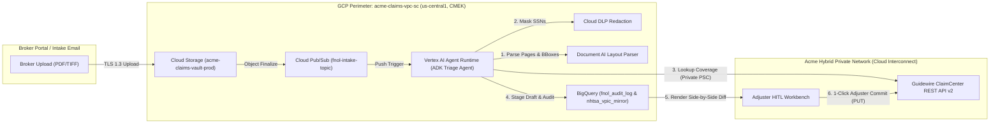

# Agent Architecture Recommendation: Commercial Auto Claims FNOL Intake & Triage Agent
Date: 2026-08-22 | Author: Lead TDL | Inputs: `docs/PRD.md`, `docs/WORKSHOP_INTAKE.md`

## 1. Recommendation
- **Tier:** **Tier 2 — Code-First ADK on Managed Vertex AI Agent Runtime**
- **Stack:** Google Agent Development Kit (`google-adk` Python) deployed on **Vertex AI Agent Runtime** (`us-central1`), **Document AI Layout Parser** + **Gemini 3** (`gemini-3`) for multi-document page classification and 42-field extraction, **Cloud Pub/Sub** for storm-surge buffering, and **BigQuery** (`acme_claims_edw`) for audit logging and NHTSA VIN table lookups.
- **Why:** The PRD requires deterministic multi-step orchestration across Document AI, custom REST calls (`GET`/`PUT`) against Guidewire ClaimCenter v2, and arithmetic confidence gates (`F-01`..`F-04`), which rules out Tier 1 (Gemini Enterprise no-code). None of the hard constraints require custom sidecars, WebSockets, or GKE node-pool customization, making Tier 2 the lowest-operational-burden choice over Tier 3.

---

## 2. Constraints → Decision Traceability

| Constraint | Source | Effect on Tier |
|---|---|---|
| Must execute authenticated `GET /v2/policies/{id}/coverage` and idempotent `PUT /v2/claims/{id}/fnol` against Guidewire ClaimCenter (`F-02`, `F-04`) | `docs/PRD.md` §4.3 | **Eliminates Tier 1:** Requires custom Python tool execution, exponential backoff retries, and schema validation before write-back. |
| Must extract 42 canonical fields with page + bounding-box coordinates across 30–80 page PDFs (`F-01`) | `docs/PRD.md` §4.3 | **Requires Tier 2/3:** Sequential pipeline combining Document AI OCR layout blocks with structured Gemini extraction. |
| Asynchronous webhook processing (`<= 90s p95` latency, 200 claims/day baseline, 60 claims/hr storm surge) | `docs/WORKSHOP_INTAKE.md` §4, `docs/PRD.md` §5 | **Fits Tier 2:** Pub/Sub push subscription + managed Agent Runtime autoscaling meets async SLA without custom streaming sidecars. |
| Strict `us-central1` data residency, `acme-claims-vpc-sc` VPC Service Controls perimeter, CMEK encryption, and HIPAA BAA | `docs/WORKSHOP_INTAKE.md` §4 | **Fits Tier 2:** Vertex AI, Document AI, Pub/Sub, and BigQuery all support VPC-SC, CMEK, and HIPAA BAA in `us-central1`. |
| Maintained by an 8-person Python/Java Claims Platform team with zero dedicated Kubernetes SREs | `docs/WORKSHOP_INTAKE.md` §4 | **Eliminates Tier 3 (GKE):** Avoids container cluster patching and scaling maintenance overhead. |

---

## 3. Alternatives Considered

| Criterion | Tier 1: Gemini Enterprise (No-Code) | Tier 2: ADK on Vertex AI Agent Runtime (Selected) | Tier 3: ADK Self-Hosted on Cloud Run / GKE |
|---|---|---|---|
| **Meets Hard Constraints** | **No** — cannot run custom 42-field bounding-box validator or idempotent Guidewire `PUT` transactions | **Yes** — full Python ADK tool control inside managed runtime | **Yes** — full control over container and runtime |
| **Team Can Maintain It** | Yes (config only) | **Yes** — Python ADK code matches team skills; zero infra patching | Medium — team must own container base images, concurrency tuning, and revision rollouts |
| **Time to First Working Agent** | N/A (cannot meet spec) | **2 weeks** (Phase 2 prototype live by Week 4) | 3–4 weeks (extra Terraform/networking boilerplate) |
| **Ops Burden** | Lowest | **Low** (managed session/runtime scaling & Cloud Trace integration) | Medium–High |
| **Estimated Monthly Run Cost (@ 1,000 claims/mo)** | N/A | **~$1,750 / mo** (Vertex AI + Document AI + Agent Runtime + BigQuery) | **~$1,900 / mo** (+ min-instance Cloud Run / GKE control plane) |

---

## 4. Component Launch Stages (Verified)

| Component | Stage | Source URL | Checked On | Production OK? |
|---|---|---|---|---|
| **Google Agent Development Kit (`google-adk` Python)** | **GA** | `https://cloud.google.com/vertex-ai/generative-ai/docs/agent-development-kit/overview` | 2026-08-22 | **Yes** |
| **Vertex AI Agent Runtime (Agent Engine)** | **GA** | `https://cloud.google.com/vertex-ai/generative-ai/docs/agent-engine/overview` | 2026-08-22 | **Yes** |
| **Document AI Layout / OCR Processor** | **GA** | `https://cloud.google.com/document-ai/docs/release-notes` | 2026-08-22 | **Yes** |
| **Cloud Pub/Sub & BigQuery** | **GA** | `https://cloud.google.com/bigquery/docs/release-notes` | 2026-08-22 | **Yes** |
| **Cloud DLP (Sensitive Data Protection)** | **GA** | `https://cloud.google.com/sensitive-data-protection/docs/release-notes` | 2026-08-22 | **Yes** |

---

## 5. System Topology & Trust Boundaries

---

## 6. Security and Compliance Controls
- **IAM & Least Privilege:** Dedicated service account `sa-fnol-agent@acme-claims-prod.iam.gserviceaccount.com` scoped strictly to `roles/aiplatform.user`, `roles/documentai.apiUser`, `roles/storage.objectViewer` (on `acme-claims-vault-prod`), and `roles/bigquery.dataEditor` (on dataset `acme_claims_edw`).
- **Network Perimeter:** All GCP services reside inside the `acme-claims-vpc-sc` VPC Service Controls perimeter; Guidewire ClaimCenter calls traverse Private Service Connect (PSC) over Cloud Interconnect with zero public internet egress.
- **Encryption & PHI Redaction:** All GCS buckets, Pub/Sub topics, and BigQuery tables enforce CMEK (`projects/acme-sec/locations/us-central1/keyRings/claims-kr`). Cloud DLP masks SSN patterns (`\d{3}-\d{2}-\d{4}`) before structured logs are emitted to Cloud Logging.

---

## 7. Risks and Open Questions

| Risk | Likelihood | Impact | Mitigation | Owner |
|---|---|---|---|---|
| VPC-SC blocks outbound calls to public NHTSA VIN decoder API | High | Medium | Mirror the NHTSA vPIC reference dataset into BigQuery (`acme_claims_edw.nhtsa_vpic_mirror`) refreshed weekly via approved data transfer pipeline | Platform Engineer |
| Storm-surge burst (60 claims/hr) exceeds Guidewire API concurrency quota | Medium | High | Configure Pub/Sub push subscription max outstanding messages = 10 and exponential backoff (`initial=2s, max=60s, max_attempts=5`) | Lead FDE |
