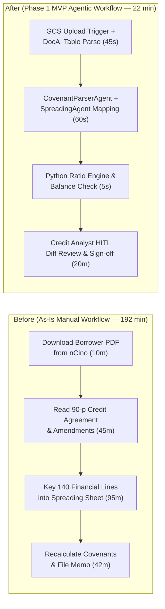

# Commercial Loan Covenant Monitoring — Strategic Use Case Canvas & MVP Alignment Doc

- **Customer / Sponsor:** Apex Commercial Bank — EVP, Commercial Credit Risk
- **Opportunity Area:** Mid-Market Commercial Loan Portfolio Surveillance ($18B AUM)
- **Use Case:** Automated Quarterly Borrower Financial Spreading & Covenant Breach Early-Warning Agent
- **Status:** Gate 1 Approved
- **Last Updated:** 2026-06-15

---

## Part I: Strategic Use Case Canvas (4-Worksheet Summary)

### 1. User Focus
* **USER TARGET:** 65 Commercial Credit Portfolio Analysts who review quarterly financial packets (audited/unaudited PDFs, rent rolls, borrowing-base certificates, and tax returns) across 4,200 active commercial borrowers (16,800 quarterly reviews/year).
* **USER PAINS:**
  * Analysts spend **3.2 hours (192 minutes) per quarterly packet** manually keying balance-sheet and income-statement lines from non-standard borrower PDFs into Moody's/nCino spreading templates.
  * Covenant definitions (e.g., Adjusted EBITDA add-backs, Fixed Charge Coverage Ratio caps) are buried in 90-page credit agreements and side-letter amendments, causing a **12.0% spreading discrepancy rate** during credit audit.
  * Review backlogs peak 45 days after quarter-end, delaying identification of deteriorating borrowers by 6–8 weeks.
* **USER GAINS:**
  * Automated pre-population of standardized financial spreads with clickable page/cell bounding-box citations back to the borrower PDF.
  * Instant reconciliation of borrower-submitted add-backs against the exact legal definitions in the executed Credit Agreement and all subsequent amendments.
  * Reduction of per-review manual spreading time from **192 minutes to 22 minutes** (88.5% cycle-time reduction).

### 2. Value Proposition
* **JOB-TO-BE-DONE:** When a commercial borrower uploads quarterly financial statements, extract and normalize every accounting line item, apply the borrower's bespoke Credit Agreement covenant formulas, and flag any breach or >15% variance for credit officer sign-off within 15 minutes.
* **PRODUCT & SERVICES:**
  * **Multi-Document Covenant Compiler:** Extracts custom DSCR, FCCR, and Leverage Ratio definitions across the master Credit Agreement and all executed amendments into a deterministic calculation graph.
  * **Automated Financial Spreader:** Maps borrower PDF tables and footnotes into the bank's 140-field canonical chart of accounts with arithmetic balance checks (`Assets == Liabilities + Equity`).
  * **Credit Analyst HITL Workbench:** Side-by-side diff UI in nCino showing extracted figures, source PDF highlights, formula trace, and one-click override logging.
* **STRATEGIC FIT (Revenue vs. Efficiency Levers):**
  * **Revenue / Capacity Impact:** Enables scaling the mid-market loan book by 25% without adding back-office credit operations headcount.
  * **Efficiency & Risk Impact:** Eliminates Q1/Q3 contractor surges and reduces regulatory MRAs (Matters Requiring Attention) from OCC credit-file audits by enforcing 100% traceable covenant math.

### 3. Business Viability
* **IMPACT:**
  * **Cycle Time:** `192 minutes → 22 minutes` per quarterly review across 16,800 annual reviews (`47,600 analyst hours/year` freed; **$4.05M gross annual labor capacity** @ $85/hr blended rate; **$2.02M net capturable value** via elimination of seasonal contractor surge and 14 avoided backfills).
  * **Audit Error Rate:** `12.0% → <1.5%` covenant calculation error rate via deterministic Python formula execution.
  * **Early Warning Lead Time:** Identifies technical covenant breaches **38 days earlier** on average after quarter-end close.
* **INVESTMENT & TEAM READINESS:**
  * 12-week Delta engagement (1 TDL, 2 FDEs, 1 Bank Data Engineer, 2 Senior Credit SME reviewers; $240K build CapEx + $92K annual GCP/Vertex AI run OpEx).
* **EXECUTION BLOCKERS:**
  * Historical scanned credit agreements prior to 2021 have low-DPI optical scans requiring Document AI high-resolution OCR fallback.
  * OCC Model Risk Management (SR 11-7) requires deterministic arithmetic execution (LLM maps line items; Python executes the formula).

### 4. Technical Feasibility & Data Readiness (`Available / Usable / Quality`)
* **DATA READINESS AUDIT:**
  * **Available:** 4,200 active Credit Agreements + amendments (PDF) in GCS Document Vault and 84,000 historical validated spreads in BigQuery (`credit_warehouse.historical_spreads`).
  * **Usable:** Centralized in GCS and BigQuery with clear ownership under Credit Risk Data Engineering; read-only service account access approved.
  * **Quality:** Post-2021 PDFs are native digital PDFs; pre-2021 agreements (18% of portfolio) are 200-DPI scans requiring Document AI Layout Parser OCR.
* **ARCHITECTURE & ENVIRONMENT:** Google Cloud ADK deployed on **Vertex AI Agent Runtime** inside the bank's VPC-SC perimeter; **Document AI Layout Parser** for table extraction; **Gemini 2.5 Pro** for line-item taxonomy mapping and legal covenant amendment resolution; deterministic Python sandbox for ratio math.

---

## Part II: Official MVP Alignment Summary Document

### 1. Overview & Business Context
* **Use Case Description:** An event-driven ADK multi-agent pipeline triggered when a commercial borrower's quarterly financial packet lands in the nCino GCS vault. The agent parses financial statements, reconciles add-backs against executed Credit Agreement amendments, computes DSCR/FCCR/Leverage ratios in Python, and stages a citation-linked spread in nCino for Credit Analyst sign-off.
* **Business Problem:** Credit analysts spend 80%+ of their quarterly review cycle performing manual data entry and hunting through multi-amendment PDFs rather than evaluating credit risk.
* **Business Objectives and Metrics (Must-Haves vs. Okay for Slippage):**

| Tier | Business Objective | Target Metric (`Baseline -> Target`) | Slippage Tolerance |
| :--- | :--- | :--- | :--- |
| **Non-Negotiable Must-Have** | Deterministic accounting identity & covenant math | `100%` arithmetic accuracy (`Assets == Liabilities + Equity`); `<1.5%` covenant mapping discrepancy | Zero slippage (OCC SR 11-7 blocker) |
| **Non-Negotiable Must-Have** | Per-packet manual spreading time reduction | `192 min -> <= 30 min` on standard C&I borrower packets | Zero slippage |
| **Okay for Slippage (Stretch)** | Automated rent-roll parsing for Commercial Real Estate (CRE) borrowers | `>= 85%` unit-level extraction accuracy | Can defer CRE rent rolls to Eval Round 2 / Phase 2 |

### 2. Process CUJ Flow Chart (Before vs. After MVP Scope)

### 3. Phase 1 (MVP) Scope
* **Features In Focus for MVP Evaluation Round 1 (Demo 1 — early sprint read-out):**
  * Document AI Layout Parser ingestion for native-digital C&I borrower Balance Sheets and Income Statements.
  * Canonical 140-field Chart of Accounts mapping with bounding-box PDF citations and deterministic balance check (`Assets == Liabilities + Equity`).
* **Features In Focus for MVP Evaluation Round 2 (Demo 2/3 — later sprint read-outs):**
  * Multi-amendment Credit Agreement covenant compiler (resolving base agreement + up to 5 chronological side-letter amendments).
  * Deterministic Python covenant calculator (DSCR, FCCR, Senior Leverage) + nCino HITL review payload export.
* **Features Not In Focus for MVP (Out of Scope):**
  * Autonomous write-back of final risk ratings to the core loan ledger without human Credit Officer sign-off.
  * Commercial Real Estate (CRE) multi-property rent-roll spreadsheet ingestion (deferred to Phase 2).
  * Unstructured borrower email negotiation automation.
* **Datasets Needed for MVP:**
  * **Golden Eval Set (`N=50`):** 50 historical borrower packets (35 standard C&I, 10 multi-amendment complex, 5 low-DPI scanned outliers) paired with audited ground-truth spreads in `credit_warehouse.historical_spreads`.
* **Assumptions and Risks:**
  * **Risk:** Pre-2021 scanned PDFs yield OCR character errors on negative parentheses `(1,240)`. **Mitigation:** Enforce strict cross-foot arithmetic sum verification; any row failing `sum(children) == subtotal` is highlighted in amber for mandatory human input.

### 4. Data Source & Agent Input/Outputs Mapping

**Solution Inputs (data sources, configs, APIs, MCPs, A2A agents):**

| Data Source | Access Method | Features Enabled |
| :--- | :--- | :--- |
| **nCino Document Vault (GCS)** | Eventarc + GCS JSON API | Ingestion of borrower quarterly financial PDFs and executed Credit Agreements / amendments |
| **BigQuery (`credit_warehouse.historical_spreads`)** | BigQuery Read API | Retrieval of borrower's prior 4 quarters of mapped chart-of-accounts line items for period-over-period variance checks |
| **Document AI Layout Parser** | Vertex / DocAI API | Structured table, cell, and bounding-box extraction from multi-page PDFs |

**Solution Outputs:**

| Data Source / Target System | Access Method | Features Enabled |
| :--- | :--- | :--- |
| **nCino Spreading Staging API** | Internal REST API (mTLS) | Pre-populates draft financial spread and citation links for Credit Analyst HITL review |
| **BigQuery (`credit_audit.spread_signoffs`)** | BigQuery Storage Write API | Immutable SR 11-7 audit log of raw LLM mappings, confidence scores, analyst overrides, and covenant results |

### 5. Evaluation and Testing Approach
* **Status Quo Quality:** Human baseline spreading discrepancy rate is **12.0%** across audited credit files, with a mean handling time of **192 minutes/packet** (`docs/as_is_report.md`).
* **UAT Required:** **Yes** (5 Senior Commercial Credit Analysts will execute blind parallel UAT across 50 held-out quarterly packets during Weeks 9–10).
* **Tentative Evaluation Metrics:**
  * **Line-Item Mapping F1 & Exact Match:** Percentage of borrower PDF line items mapped to the exact canonical Chart of Accounts code AND exact numeric value (`Target >= 96.0%`; Status Quo: `88.0%`).
  * **Covenant Breach Recall:** Percentage of true technical covenant breaches flagged (`Target == 100.0%`).
  * **Relevant Business Metric:** Analyst hours per quarterly review (`192 min -> <= 22 min`) and OCC audit discrepancy rate (`12.0% -> <1.5%`).

### 6. (Future) Phase 2+ Scope
* **Long-Term Vision:** Expand from quarterly post-close financial spreading to continuous real-time portfolio risk surveillance across all commercial lending divisions.
* **Potential Future Features / Needs:**
  * Commercial Real Estate (CRE) rent-roll and property operating statement ingestion.
  * Automated draft generation of the narrative Annual Credit Review memo.
