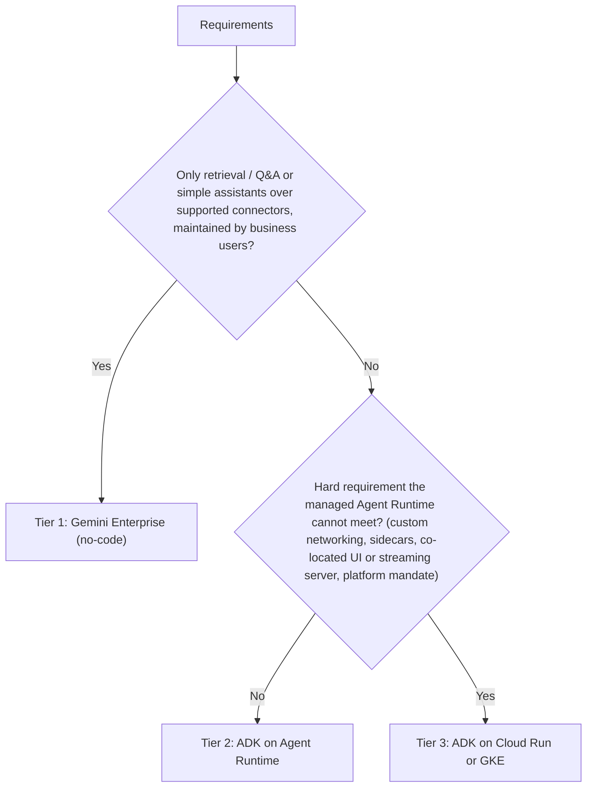

# GCP Agent Architecture Advisor (`gcp-agent-architecture-advisor`)

Turns requirements into one defensible tier choice plus the evidence behind it. The most common failure is recommending a product on stale knowledge, so **launch stages are always looked up, never recalled.**

---

## Quick-Start & File Contract

| Attribute | Specification |
| :--- | :--- |
| **Engagement Phase & Timebox** | **Phase 1 Foundations (Weeks 1–2):** 3.0-hour architecture tier selection & ARB review |
| **Time-to-Market (TTM) Compression** | **20.0h manual $\rightarrow$ 3.0h skill-guided (`85.0%` faster architecture decision & launch-stage verification)** |
| **Reads (Inputs)** | `docs/PRD.md`, `docs/WORKSHOP_INTAKE.md` (plus [`references/model-economics-config.json`](references/model-economics-config.json)) |
| **Writes (Outputs)** | `docs/ARCHITECTURE_RECOMMENDATION.md` |
| **Value Realization Linkage** | Prevents over-engineering OpEx (picks lowest ops-burden tier meeting hard constraints) and optimizes token unit economics via frontier/flash routing splits |

---

## 1. The three tiers

| Tier | What it is | Choose when | You operate |
|---|---|---|---|
| **Tier 1 - No-code** | Agents built and used inside **Gemini Enterprise** (and its prebuilt/search agents and connectors) | Knowledge Q&A, enterprise search, simple assistants over supported connectors; business users maintain it | Configuration only |
| **Tier 2 - Code-first, managed runtime** | Agent written with **ADK**, deployed to **Agent Runtime** (the managed agent hosting service, formerly "Vertex AI Agent Engine") | Custom tools, APIs, multi-step or multi-agent logic, managed sessions/memory, optional publishing to Gemini Enterprise | Agent code; the platform runs it |
| **Tier 3 - Code-first, self-hosted** | ADK agent (or another framework) on **Cloud Run** or **GKE** | Custom networking or serving needs, sidecars, unusual scaling, streaming/UI in the same service, strict platform standardization | Code, container, scaling, networking |

Tier 2 and Tier 3 use the same ADK code. Moving between them is mostly a deployment change, so pick the lowest operational burden that meets the hard constraints.

---

## 2. Decision procedure

### Step 1: Extract constraints from the inputs
Read `docs/PRD.md` and `docs/WORKSHOP_INTAKE.md` (from [workshop-intake](../workshop-intake/SKILL.md)). Record each constraint with the source line it came from:
- **Logic:** retrieval/Q&A only vs. tool calls vs. multi-step or multi-agent orchestration
- **Integrations:** supported connectors vs. custom REST/gRPC vs. on-prem systems
- **Data and compliance:** residency, VPC Service Controls, CMEK, PHI/PCI, audit needs
- **Interaction:** chat in Gemini Enterprise vs. an embedded or custom UI vs. voice or streaming
- **Maintainers:** business analysts vs. an engineering team, and who is on call
- **Scale and latency:** peak QPS, p95 latency target, cost ceiling

### Step 2: Apply the decision tree

A "cannot meet" claim in the second branch must cite the doc or test that shows the gap. A preference is not a hard requirement.

### Step 3: Verify launch stages (mandatory)
For every component in the recommended stack (runtime, model, memory/sessions, gateway, connectors, eval tooling):
1. Look up its current launch stage (`GA`, `Preview`, `Experimental / Private Preview`) on the official Google Cloud documentation or release-notes page.
2. Record the stage, the URL and the date checked.
3. Preview components may be used in pilots. Use them in production only with the client's explicit acceptance of Preview terms, recorded in the recommendation.
4. If you cannot access the docs, mark the stage **UNVERIFIED** and list it as an open risk. Do not fill it in from memory.

### Step 4: Write `docs/ARCHITECTURE_RECOMMENDATION.md`
Include all 7 sections: `1. Recommendation`, `2. Constraints -> decision`, `3. Alternatives considered (Tier 1 vs Tier 2 vs Tier 3)`, `4. Component launch stages (verified)`, `5. Topology (Mermaid with trust boundaries)`, `6. Security and compliance`, and `7. Risks and open questions`.

---

## 3. Hand-offs

- **Tier 2 or 3:** the implementation plan goes to [specification-engineer](../specification-engineer/SKILL.md) (`docs/TDD.md`) and the Phase 2 build.
- **Security:** feed section 6 into Pillar 3 (`GOVERN`) of `docs/TDD.md`.
- **Cost & Model Routing:** ground token unit economics and model tier routing in [`references/model-economics-config.json`](references/model-economics-config.json) and feed the cost drivers into [ai-value-sizing](../ai-value-sizing/SKILL.md) for TCO.

---

## 4. Customer Sign-Off & Quality Gate

| Gate Criterion | Approve When | Reject If |
| :--- | :--- | :--- |
| **Constraint-to-Tier Traceability** | Every tier selection (`Tier 1`, `Tier 2`, or `Tier 3`) cites exact lines from `docs/PRD.md` and `docs/WORKSHOP_INTAKE.md`. | Picks Tier 3 "for flexibility" without a documented hard constraint or picks Tier 1 when custom write tools are required. |
| **Verified Launch Stages** | Every stack component lists its verified launch stage (`GA` / `Preview` / `UNVERIFIED`), official doc URL, date checked, and production suitability. | Assert launch stages from memory without URLs/dates or deploys unapproved Preview components to production. |
| **Perimeter & Token Economics** | Includes trust-boundary topology (VPC-SC, IAM principals, CMEK) and token cost routing from `model-economics-config.json`. | Omits IAM least-privilege boundaries or ignores per-turn token cost drivers. |

---

## 5. References & Worked Example

- [Model Economics & Routing Reference (`model-economics-config.json`)](references/model-economics-config.json): Per-1M-token pricing, context window, latency, and downsampling split benchmarks across frontier and fast model tiers.
- [Worked Example: Commercial Auto Claims FNOL Architecture Recommendation](examples/architecture-recommendation-example.md): Complete `docs/ARCHITECTURE_RECOMMENDATION.md` showing constraint-to-tier traceability, Tier 1–3 comparison, verified GA launch stages, VPC-SC Mermaid topology, and least-privilege IAM specification.
