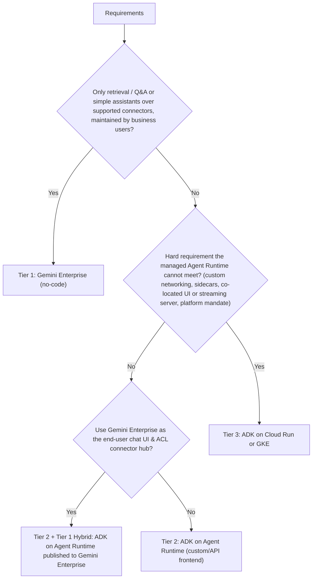

# GCP Agent Architecture Advisor (`gcp-agent-architecture-advisor`)

Turns requirements into one defensible tier choice plus the evidence behind it. The most common failure is recommending a product on stale knowledge, so **launch stages are always looked up, never recalled.**

---

## Quick-Start & File Contract

| Attribute | Specification |
| :--- | :--- |
| **Engagement Phase & Timebox** | **Phase 1 Foundations (Weeks 1–2)** |
| **Reads (Inputs)** | `docs/PRD.md`, `docs/WORKSHOP_INTAKE.md` (plus [`references/model-economics-config.json`](references/model-economics-config.json)) |
| **Writes (Outputs)** | `docs/ARCHITECTURE_RECOMMENDATION.md` |

---

## 1. The three tiers (plus the Tier 2 + Tier 1 hybrid)

| Tier | What it is | Choose when | You operate |
|---|---|---|---|
| **Tier 1 - No-code** | Agents built and used inside **Gemini Enterprise** (and its prebuilt/search agents and connectors) | Knowledge Q&A, enterprise search, simple assistants over supported connectors; business users maintain it | Configuration only |
| **Tier 2 - Code-first, managed runtime** | Agent written with **ADK**, deployed to **Agent Runtime** (the managed agent hosting service, formerly "Vertex AI Agent Engine") | Custom tools, APIs, multi-step or multi-agent logic, managed sessions/memory | Agent code; the platform runs it |
| **Tier 2 + Tier 1 Hybrid (Most common enterprise pattern)** | Custom **ADK** agent deployed on **Agent Runtime** and published into **Gemini Enterprise** (`agents-cli publish gemini-enterprise` / Agent Registry) | Customer wants Gemini Enterprise SSO, chat UI, and ACL-enforced workspace/data connectors **plus** custom ADK tools or deterministic workflows | Agent code + Gemini Enterprise registration |
| **Tier 3 - Code-first, self-hosted** | ADK agent (or another framework) on **Cloud Run** or **GKE** | Custom networking or serving needs, sidecars, unusual scaling, streaming/UI in the same service, strict platform standardization | Code, container, scaling, networking |

Tier 2 and Tier 3 use the same ADK code. Moving between them is mostly a deployment change, so pick the lowest operational burden that meets the hard constraints.

---

## 2. Decision procedure

### Step 1: Extract constraints from the inputs
Read `docs/PRD.md` and `docs/WORKSHOP_INTAKE.md` (from [workshop-intake](../workshop-intake/SKILL.md)). Record each constraint with the source line it came from:
- **Logic:** retrieval/Q&A only vs. tool calls vs. multi-step or multi-agent orchestration
- **Integrations:** supported connectors vs. custom REST/gRPC vs. on-prem systems
- **Data and compliance:** residency, VPC Service Controls, CMEK, PHI/PCI, audit needs
- **Interaction:** chat in Gemini Enterprise vs. an embedded or custom UI vs. voice or streaming
- **Maintainers:** business analysts vs. an engineering team, and who is on call
- **Scale, latency, and quota model:** peak QPS, p95 latency target, cost ceiling, and whether concurrency requires **Provisioned Throughput (GSU)** vs. **Dynamic Shared Quota (Pay-As-You-Go)**

### Step 2: Apply the decision tree

A "cannot meet" claim in the `C` branch must cite the doc or test that shows the gap. A preference is not a hard requirement.

### Step 3: Verify launch stages & pricing SKUs (mandatory)
For every component in the recommended stack (runtime, model, memory/sessions, gateway, connectors, eval tooling):
1. Look up its current launch stage (`GA`, `Preview`, `Experimental / Private Preview`) and public Vertex AI SKU pricing on the official Google Cloud documentation or release-notes page.
2. Record the stage, the URL, and the date checked. Never copy internal-only codenames or unverified planning rates from `model-economics-config.json` into a client-facing document without live verification.
3. Preview components may be used in pilots. Use them in production only with the client's explicit acceptance of Preview terms, recorded in the recommendation.
4. If you cannot access the docs, mark the stage **UNVERIFIED** and list it as an open risk. Do not fill it in from memory.

### Step 4: Write `docs/ARCHITECTURE_RECOMMENDATION.md`
Include all 7 sections: `1. Recommendation`, `2. Constraints -> decision`, `3. Alternatives considered (Tier 1 vs Tier 2 / Hybrid vs Tier 3)`, `4. Component launch stages (verified)`, `5. Topology (Mermaid with trust boundaries)`, `6. Security and compliance`, and `7. Risks, quota model (PayGo vs. Provisioned Throughput), and open questions`.

---

## 3. Hand-offs

- **Tier 2 or 3:** the implementation plan goes to [specification-engineer](../specification-engineer/SKILL.md) (`docs/TDD.md`) and the Phase 2 build.
- **Security:** feed section 6 into Pillar 3 (`GOVERN`) of `docs/TDD.md`.
- **Cost & Model Routing -> `ai-value-sizing`:** compute annual token OpEx from `SOM` volume (`docs/VALUE_SIZING.md`), per-turn fan-out (`agent-load-testing`), and [`references/model-economics-config.json`](references/model-economics-config.json) before passing `--annual-opex` to `calculate_roi.py`:
  $$\text{Annual Token OpEx} = \text{SOM}_{\text{units}} \times \text{Turns}_{\text{per unit}} \times \sum_{m \in \{\text{flash}, \text{frontier}\}} N_{\text{calls}, m} \times \frac{(T_{\text{uncached}, m} \cdot P_{\text{in}, m}) + (T_{\text{cached}, m} \cdot P_{\text{cache}, m}) + (T_{\text{out}, m} \cdot P_{\text{out}, m})}{10^6}$$

---

## 4. References & Worked Example

- [Model Economics & Routing Reference (`model-economics-config.json`)](references/model-economics-config.json): Per-1M-token planning baseline rates, context windows, latency tiers, and cascaded routing splits across fast and frontier models.
- [Worked Example: Commercial Auto Claims FNOL Architecture Recommendation](examples/architecture-recommendation-example.md): Complete `docs/ARCHITECTURE_RECOMMENDATION.md` showing constraint-to-tier traceability, Tier 1–3 comparison, verified GA launch stages, VPC-SC Mermaid topology, and least-privilege IAM specification.
