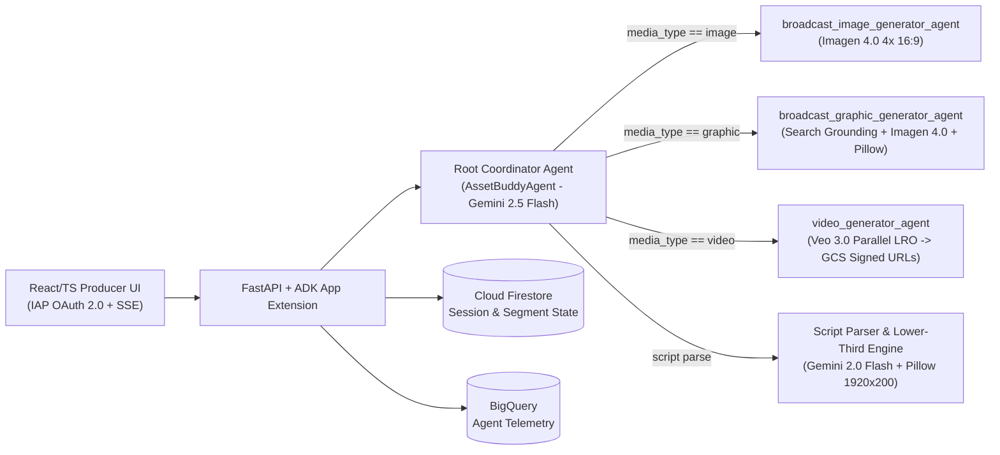

# Worked Example: Broadcast News "Asset Buddy" Multi-Agent System (`docs/TDD.md`)

This worked example demonstrates a completed **Enterprise Agent Technical Specification (`go/delta-squad-agent-specs`)** for a broadcast television newsroom multi-agent system (**Asset Buddy**).

**Legend:**
- **✳️ Mandatory:** Completed for approvals and squad provisioning.
- **👥 Joint Effort:** Collaboration between TDL and FDE Tech Lead.

---

# Part I: Project Context

## A. Project Administration

| Attribute | Details / Values |
| :--- | :--- |
| **✳️ Use Case Name** | Broadcast News Transformation — Use Case 2: Asset Buddy |
| **✳️ Customer / Client** | Global Broadcast Media Network |
| **✳️ Primary Client Contacts** | **Business Sponsor:** VP Editorial Operations<br>**Lead Engineer / POC:** Director of Newsroom Production Systems<br>**Security Officer:** Enterprise Cloud CISO Lead |
| **✳️ Google TDL** | Enrique Chan |
| **✳️ Google FDE Tech Lead** | Christianna Clark |
| **✳️ Target Milestones** | **Project Start Date:** 2026-05-01<br>**Discovery Sign-off:** 2026-05-27<br>**Squad Target Start Date:** 2026-05-27 |
| **✳️ Primary Goal** | **Asset Buddy:** An intelligent multi-agent script-analysis system that parses television rundown scripts (`VO`, `ON CAM`, `SOT`) to suggest lower-third banners, editorial copy, and broadcast-ready visual assets (16:9 images, composited news graphics, and 8-second b-roll videos) adhering to show-specific brand guidelines. |
| **Salesforce Opportunity ID / Expert Request** | `ER-388458` |
| **Buganizer / Jira / Epic Tracker Link(s)** | `b/425493372` |
| **Shared Collaboration** | **Shared Drive:** `Broadcast News Transformation Workspace`<br>**Git Repository:** `ws2-ws3-asset-design-buddies` |

---

# Part II: Use Case Specification

## A. Business Goal & Problem Statement

* **✳️ Core Problem Statement:** Develop a web-based **Asset Buddy** application where a broadcast producer can input a news script (by referencing an Avid iNEWS rundown ID or pasting script text). The multi-agent system analyzes narrative blocks and generates distinct, show-branded options for both editorial copy (lower thirds, verified bullet points) and visual assets (16:9 photorealistic backgrounds, composited info-graphics, and b-roll video clips). Producers review, regenerate, or download assets directly into the control-room workflow.
* **✳️ Target Business Outcome:** Reduce manual broadcast graphic and b-roll compilation time by **80%** (saving **25+ producer hours/week per show**), eliminate brand-guideline violations across morning and nightly broadcasts, and enable producers to break live news with verified visuals in under 10 seconds.

## B. ✳️ Measurable Success Metrics (KPIs)

- [x] **Time Savings / Productivity:** Reduces manual asset search and graphic compilation time by **80%** (saves 25 hours/week per production unit).
- [x] **Task Accuracy & Grounding:** **>95%** factual grounding precision on extracted graphic bullet points and statistics (verified against source script and Google Search grounding).
- [x] **Latency Threshold:** **< 10 seconds** p95 for 4x 16:9 Imagen 4.0 image/graphic generation; **< 15 seconds** for Gemini 2.5 Flash full rundown script segmentation; **< 300 seconds** LRO timeout for 4x parallel Veo 3.0 8-second b-roll clips.
- [x] **Operational Volume:** Supports **100+ concurrent broadcast producers** across morning, daytime, and nightly news rundowns (**100 QPS** peak breaking-news burst).

## C. ✳️ Users & Critical User Journeys (CUJs)

* **Primary Target Persona(s):**
  - **Producing Staff:** Line Producers, Segment Producers, Production Assistants (PAs).
  - **Execution & Technical Crew:** Control Room Directors, Broadcast Graphics Operators, Stage Managers.
* **End-to-End 5-Stage User Journey:**
  1. **Stage 1 — Ingest & Segment:** Producer inputs raw broadcast script text containing production markers (`(VO)`, `(ON CAM)`, `(SOT)`). The system parses narrative blocks into structured segments tied to an active `session_id`.
  2. **Stage 2 — Route & Brand Hydration:** The **Coordinator Agent (`AssetBuddyAgent`)** inspects `session.state["media_type"]` (`image`, `graphic`, `video`, or `lower_third`), fetches the show's style guide (`morning-show`, `nightly-news`, `news-daily`, `streaming-news-now`), and hydrates hex color palettes, typography rules, and diffusion modifiers into state via `before_agent_callback`.
  3. **Stage 3 — Real-Time Grounding & Prompt Enrichment:** For graphics, Gemini queries Google Search grounding to verify statistics and extract 1–5 concise bullet points. For images and video, Gemini expands the producer's brief into a 16:9 cinematic diffusion prompt.
  4. **Stage 4 — Multi-Modal Model Execution & Compositing:**
     - **Images:** **Imagen 4.0** generates 4 high-resolution `1920x1080` (16:9) photorealistic variations.
     - **Graphics:** **Imagen 4.0** generates uncluttered background textures (with negative prompts blocking text/faces), and the **Python Pillow Engine** composites wrapped bullet text, brand accent bars, and the official network logo.
     - **Videos:** **Veo 3.0** renders 4 parallel 8-second 16:9 b-roll clips via async Long-Running Operations (LRO).
     - **Lower-Thirds:** **Gemini 2.0 Flash** drafts `<8 word` active-voice headlines, and Pillow renders `1920x200` RGBA dual-tier banner previews.
  5. **Stage 5 — Secure Delivery & Presentation:** Variations are returned in a uniform JSON contract (`Base64` PNGs for instant graphic preview; 1-hour V4 signed GCS URLs for video streaming) over real-time Server-Sent Events (SSE).

## D. High-Level Solution Concept & UX Modality

### 1. Proposed Agentic Architecture



### 2. ✳️ UX Modality & User Interface 👥
- [ ] **Gemini Enterprise (App) Integration**
- [x] **Standalone Web & Mobile Applications:**
  - [x] **Desktop Web Portal:** Dedicated browser-based React/TypeScript newsroom dashboard & chat interface.
- [x] **Embedded Client Overlay:** Planned Phase 2 integration into proprietary NRCS rundown client (client-owned).
- [ ] **Automated / Batch Trigger**

### 3. ✳️ Expected Inputs & Outputs 👥
* **Expected Inputs:**
  - `raw_script_text`: Broadcast script with `(VO)`, `(ON CAM)`, `(SOT)` markers.
  - `selection_text` & `segment_id`: Targeted story beat text.
  - `custom_prompt`: Producer natural-language visual direction.
  - `media_type`: `"image" | "graphic" | "video" | "lower_third"`.
  - `style_name`: `"morning-show" | "nightly-news" | "news-daily" | "streaming-news-now" | "default"`.
  - `style_guide_image`: Optional Base64 reference image for style/video seed framing.
* **Expected Outputs:**
  - Uniform Asset JSON Envelope containing `id`, `segmentId`, `type`, `title`, `enhanced_prompt`, and `variations[]` (`Base64 PNG` or 1-hour V4 signed GCS URLs).
  - Live Server-Sent Events (SSE) streaming agent transfers and tool progress.

### 4. ✳️ Data Requirements
- [x] **Mock Data Needed for MVP Development?:** [x] Yes [ ] No — Curated show style guides & 50 golden sample broadcast scripts.
- [x] **Real Data Needed for MVP Development?:** [ ] Yes [x] No — Public broadcast scripts contain no customer PII/PHI.

### 5. Architectural Review Board (ARB) Alignment
No blocking external ARB required for MVP staging deployment; adheres to client Cloud Security CISO baseline (Zero-Trust IAP + private VPC).

## E. ✳️ Out-of-Scope Boundaries
* Direct write-back mutation into legacy Avid iNEWS NRCS hardware servers during Phase 1 MVP (producers download/copy approved assets).
* Cross-workstream merger with Workstream 3 (Design Buddy) will be owned by client engineering post-handoff.

---

# Part III: Platform Infrastructure & Developer Clearance

## A. Onboarding & Developer Access Clearance Checklist 👥
- [x] **✳️ Client Workstation / VDI Access:** Direct Bring-Your-Own-Device (BYOD) with Workload Identity Federation (WIF) access.
- [x] **✳️ GCP Project Access Mapping:**
  - **Development Environment Project ID:** `broadcast-google-argolis-dev`
  - **Staging / Production Environment Project ID:** `ws2-studio-production`
  - **Code Handoff Target:** Client Cloud Source Repositories (`ws2-ws3-asset-design-buddies`)
- [x] **✳️ IAM Roles Checklist (Granted to Delivery Team & `asset-buddy-sa`):** 👥
  - [x] `roles/aiplatform.user` *(Vertex AI Gemini, Imagen 4.0, Veo 3.0 & Reasoning Engine)*
  - [x] `roles/storage.admin` *(GCS staging & V4 signed URL generation)*
  - [x] `roles/secretmanager.secretAccessor` *(Secret & SA key hydration)*
  - [x] `roles/datastore.user` *(Firestore session state persistence)*
  - [x] `roles/logging.logWriter` & `roles/cloudtrace.agent` *(Observability)*
  - [x] `roles/iap.httpsResourceAccessor` *(Zero-Trust IAP web ingress)*

## B. Google Cloud Service Enablement Matrix 👥

| Service Category | Google Cloud API Name | API Service Identifier | Enabled (Y/N) | Technical Role & Dependency Justification |
| :--- | :--- | :--- | :---: | :--- |
| **Compute & Web Hosting** | App Engine Admin & Flex API | `appengine.googleapis.com` | **[Y]** | Hosts monolithic container (`python:3.12-slim` + `fonts-noto` + `Pillow` + `uvicorn`) serving React SPA and FastAPI backend. |
| | Artifact Registry API | `artifactregistry.googleapis.com` | **[Y]** | Stores versioned Docker images (`asset-buddy-repo`) deployed via Terraform. |
| | Cloud Build & Cloud Run API | `cloudbuild.googleapis.com`, `run.googleapis.com` | **[Y]** | Automated container build pipelines and auxiliary worker services. |
| **Core AI & Generative Media** | Vertex AI API | `aiplatform.googleapis.com` | **[Y]** | Powers **Gemini 2.5 Flash** (coordinator/grounding), **Gemini 2.0 Flash** (lower-thirds), **Imagen 4.0** (16:9 images/backgrounds), and **Veo 3.0** (b-roll LROs). |
| | Cloud Telemetry API | `cloudtelemetry.googleapis.com` | **[Y]** | Real-time inference telemetry, token analytics, and ADK agent span export. |
| | Video Intelligence & Transcoder | `videointelligence.googleapis.com`, `transcoder.googleapis.com` | **[Y]** | B-roll corpus frame indexing, shot-boundary detection, and broadcast container transcoding. |
| **Databases, Storage & Secrets** | Cloud Storage JSON API | `storage.googleapis.com` | **[Y]** | Stores rendered Veo videos, brand logos/fonts, and serves 1-hour V4 signed URLs. |
| | Cloud Firestore API | `firestore.googleapis.com` | **[Y]** | Low-latency persistence for active rundown sessions, parsed segments, and trace correlation. |
| | Secret Manager API | `secretmanager.googleapis.com` | **[Y]** | Stores `asset-buddy-sa-key` for offline V4 signed URL generation and Maps API keys. |
| | BigQuery API | `bigquery.googleapis.com` | **[Y]** | Central telemetry warehouse (`broadcast_news_analytics`) for token/cost/latency auditing. |
| **Security & Governance** | Identity-Aware Proxy (IAP) API | `iap.googleapis.com` | **[Y]** | Enforces corporate Google OAuth 2.0 ingress (`X-Goog-Authenticated-User-Email`). |

## C. Client Architecture & Shared Components Baseline 👥
* **Data Stores:** Cloud Firestore (Datastore mode) for live session state; BigQuery for telemetry; multi-bucket GCS (`asset-buddy-poc`) for staging, `/videos`, and brand style assets.
* **Async Queues:** Cloud Tasks / Celery + Redis for non-blocking parallel Veo 3.0 4x b-roll LRO polling; Cloud Pub/Sub for rundown revision events.
* **Identity:** Enterprise Okta SAML 2.0 federated with Google Cloud Identity + Identity-Aware Proxy (IAP).

---

# Part IV: Deep-Dive Agent Technical Specifications

## Pillar 1: BUILD (Agent Architecture, Models & Tools)

### A. Agent Identity & Topology
- **✳️ Agent System Name:** `asset_buddy_agent` (Root Coordinator Class: `AssetBuddyAgent`)
- **✳️ Agent Display Name:** `"Asset Buddy - AI Broadcast Production Assistant"`
- **✳️ Agent Archetype & Topology:** 👥
  - **Coordinator / Dispatcher Multi-Agent System (`google.adk.agents.LlmAgent`):** Root coordinator inspects `session.state["media_type"]`, runs pre-delegation callback `_prepare_generation_state`, and invokes `transfer_to_agent` to route to:
    1. `broadcast_image_generator_agent`: High-res 16:9 broadcast image diffusion.
    2. `broadcast_graphic_generator_agent`: Search-grounded bullet extraction + Imagen 4.0 background + Pillow raster compositor.
    3. `video_generator_agent`: Parallel Veo 3.0 b-roll video clip generation.
- **✳️ Primary LLM Orchestrator & Model Suite:**
  - **Orchestrator & Grounding:** `gemini-2.5-flash` / `gemini-2.0-flash-001`
  - **Image & Graphic Background Diffusion:** `imagen-4.0-generate-preview-06-06`
  - **Video B-Roll Diffusion:** `veo-3.0-fast-generate-preview`

### B. System Instructions & Behavioral Rules 👥

* **Coordinator Agent (`AssetBuddyAgent`) Instructions:**
```text
You are Asset Buddy, a media generation coordinator for broadcast newsrooms.
Workflow:
1. Check the `media_type` key in `session.state`.
2. Delegate to the matching specialist sub-agent using `transfer_to_agent`:
   - If `media_type == 'image'`, transfer to `broadcast_image_generator_agent`.
   - If `media_type == 'graphic'`, transfer to `broadcast_graphic_generator_agent`.
   - If `media_type == 'video'`, transfer to `video_generator_agent`.
3. DO NOT generate media yourself; your sole responsibility is deterministic routing.
```

* **Anti-Hallucination & Broadcast Compliance Directives:**
  - **Strict Grounding:** Graphic bullet points (max 5 items) must derive directly from `selection_text` or verified Google Search grounding citations.
  - **Negative Prompts on Graphic Backdrops:** Strictly enforce `negative_prompt="text, words, letters, characters, fonts, signage, writing, logos, people, humans, faces"` and `person_generation="dont_allow"` on all graphic background calls so Pillow text overlays remain legible.

### C. Data Modalities & Grounding
- **Grounding Connectors:** Real-Time Google Search Grounding in Gemini 2.5 Flash; Avid iNEWS XML/JSON rundown feeds; Cloud Firestore state persistence.
- **Multimodal Ingestion:** Reference brand PNG/JPEG images (`Image(gcs_uri=..., mime_type="image/png")`), broadcast scripts (`VO`, `SOT`, `ON CAM`), and Vision Warehouse video index.

### D. Tooling, MCP & Code Execution 👥

```python
from typing import Any, Literal, Optional
from pydantic import BaseModel, Field


class StyleGuideConfig(BaseModel):
    style_name: Literal["morning-show", "nightly-news", "news-daily", "streaming-news-now", "default"]
    primary_hex: str = Field(..., pattern=r"^#[0-9A-Fa-f]{6}$")
    secondary_hex: str = Field(..., pattern=r"^#[0-9A-Fa-f]{6}$")
    style_modifiers: str
    style_description: str


class AssetVariation(BaseModel):
    variation_id: int = Field(..., ge=1, le=4)
    mime_type: Literal["image/png", "video/mp4"]
    payload_b64_or_signed_url: str
    expires_at_iso: Optional[str] = None


class BroadcastAssetEnvelope(BaseModel):
    id: str
    segment_id: Optional[str]
    type: Literal["image", "graphic", "video", "lower_third"]
    title: str = Field(..., max_length=80)
    enhanced_prompt: str
    variations: list[AssetVariation] = Field(..., min_length=1, max_length=4)
```

* **Timeout & Error Fallback Matrix:**

| Tool / Model Call | Timeout Threshold | Retry Policy | Fallback Behavior |
| :--- | :--- | :--- | :--- |
| `analyze_script_and_generate_media` (Gemini 2.0/2.5 Flash) | `15.0s` | 2 retries (`0.5s`, `1.5s` backoff) | Return structured JSON error envelope; preserve parsed raw segments |
| `generate_broadcast_image` / `generate_graphic` (Imagen 4.0 + Pillow) | `30.0s` | 2 retries on `429`/`503` | Fall back to pre-approved show brand slate texture + Pillow text overlay |
| `generate_multiple_videos_parallel` (Veo 3.0 LRO) | `300.0s` (poll every `15s`) | 1 retry per failed clip | Return partial completed variations (1–3 clips) with structured warning |

### E. Gemini Enterprise App Integration
- **A2A Routes Configured:** Exposes `GET /a2a/app/.well-known/agent-card.json` and `POST /a2a/app/run_rpc` via `AdkAppExtension` for inter-agent discovery with Workstream 1 (Insights Generator) and Workstream 3 (Design Buddy).

---

## Pillar 2: SCALE (Runtime, State & Memory Bank)

### A. Load & Concurrency Expectations
- **✳️ MVP Active Users:** `5` news producers | **Production Target Users:** `100+` concurrent producers across 4 broadcast networks.
- **✳️ Peak Concurrent Sessions:** `100` active rundown sessions | **Expected QPS:** `100 requests/sec` peak breaking-news burst.

### B. Agent Platform Sessions & State Management 👥
- **Session State Keys (`session.state`):**
```python
user_id: str                        # Authenticated producer email from IAP header
session_id: str                     # Active newsroom rundown session UUID
media_type: str                     # "image" | "graphic" | "video" | "lower_third"
selection_text: str                 # Parsed script segment text (VO, SOT, ON CAM)
custom_prompt: str                  # Producer visual instruction
segment_id: Optional[str]           # Targeted rundown segment ID
generation_task_prepared: bool      # Coordinator readiness flag
style_name: str                     # Show brand template identifier
style_config: dict[str, Any]        # Hydrated hex colors, font paths, margins
title: Optional[str]                # Graphic/banner headline (<8 words)
bullet_points: Optional[list[str]]  # 1-5 grounded objective bullet points
broadcast_image_response: Optional[dict[str, Any]]
broadcast_graphic_response: Optional[dict[str, Any]]
broadcast_video_response: Optional[dict[str, Any]]
```
- **Session Persistence Engine:** **Google Cloud Firestore** (Datastore mode) in production; ephemeral in-memory dict (60-min TTL) in local dev.

### C. Agent Platform Memory Bank (Cross-Session Recall) 👥
- **Enable Google Memory Bank:** **Yes** — Retains recurring producer show assignments (`Network Show Affinity`), preferred graphic bullet layouts, and show entity glossaries.
- **Memory Retention TTL:** `90 days` with `PreloadMemory` auto-injecting show defaults on turn start and `LoadMemory` querying past asset prompts.

### D. Cost Controls 👥
- **ADK Context Caching:** **60-minute TTL** for show style guides and few-shot rundown segmentation examples.
- **Usage Limits:** `5,000,000 tokens/day` per producer session; max `50` turns per session; max `4` parallel Veo 3.0 LRO operations per request.

---

## Pillar 3: GOVERN (Security, Gateway, Identity & Registry)

### A. ✳️ Agent Identity & Delegated Auth 👥
- **Service Account:** `asset-buddy-sa@<PROJECT_ID>.iam.gserviceaccount.com` with least-privilege roles.
- **Ingress Auth:** Enforced by Google Cloud Load Balancer + **Identity-Aware Proxy (IAP)** validating `X-Goog-Authenticated-User-Email` and `X-Goog-IAP-JWT-Assertion`.

### B. ✳️ Agent Gateway & Network Security 👥
- **Zero-Trust Ingress:** Public unauthenticated ingress disabled; VPC firewall rules restricted solely to Google Cloud health check ranges (`35.191.0.0/16`, `130.211.0.0/22` on port `8080`).
- **Data Residency:** Strictly hosted in `us-central1` (Iowa).

### C. ✳️ Governance Policies & Content Guardrails 👥
- **Vertex AI Safety Filters:** `safety_filter_level="block_few"`; `person_generation="dont_allow"` on graphic textures; hardcoded negative prompts preventing text/logo artifacts on backdrops; `<8 word` programmatic constraint on lower-third banners.

### D. Agent Registry & Discoverability 👥
- **Tagged Skills in `agent-card.json`:** `script_analysis_and_segmentation`, `lower_third_banner_generation`, `broadcast_image_generation`, `broadcast_graphic_generation`, `video_broll_generation`.

### E. ✳️ Sensitive Data / PII / PHI Handling
- **PII/PHI Expected:** **No** (public news reporting). Service account keys decoded strictly in-memory from Secret Manager and never emitted to Cloud Logging.

### F. ✳️ Security Guardrails Summary
- **Canned Fallback Envelope:** `{"error": "Operation finished with no result. Content may have been blocked by broadcast safety policy."}`.

---

## Pillar 4: OPTIMIZE (Evaluation, Observability & Analytics)

### A. Offline Evaluation & Executable Acceptance Matrix 👥
- **Golden Dataset:** 50+ curated broadcast news rundowns (breaking news, economic reports, severe weather) across all 4 network show styles.

| PRD Requirement | Test File / Suite | Verification Case | Executable Command |
| :--- | :--- | :--- | :--- |
| `FR-1`: Script segmentation (`VO`, `SOT`, `ON CAM`) | `tests/test_script_parser.py` | `test_parse_rundown_segments_and_markers` | `pytest tests/test_script_parser.py -q` |
| `FR-2`: Lower-third `<8 words` & RGBA banner | `tests/test_lower_thirds.py` | `test_banner_headline_word_count_and_dimensions` | `pytest tests/test_lower_thirds.py -q` |
| `FR-3`: Graphic grounding & Pillow 1920x1080 composite | `tests/test_graphic_compositor.py` | `test_pillow_composite_margins_and_logo_overlay` | `pytest tests/test_graphic_compositor.py -q` |
| `FR-4`: Coordinator `media_type` routing | `tests/test_coordinator_agent.py` | `test_coordinator_transfers_to_matching_subagent` | `pytest tests/test_coordinator_agent.py -q` |

### B. Deployment & Online Continuous Evaluation 👥
- **OpenTelemetry & Cloud Trace:** `AdkAppExtension(enable_tracing=True)` capturing HTTP request spans, `transfer_to_agent` handoffs, Gemini inferences, and Imagen/Veo calls.
- **Cloud Monitoring Alerts:** VM CPU/memory `>80%`, HTTP 5xx `>1%`, Veo LRO timeout `>300s`, and Vertex AI quota exhaustion.

### C. Troubleshooting & Automatic Optimization 👥
- **Unified Trace Viewer:** Turn-by-turn agent execution tree inspection in Cloud Trace correlated with structured JSON logs in Cloud Logging.

### D. Out-of-the-Box BigQuery Agent Analytics 👥
- **BigQuery Telemetry & Looker Studio:** Streams `prompt_tokens`, `completion_tokens`, `latency_ms`, `media_type`, and `style_name` to BigQuery (`broadcast_news_analytics`) powering a Looker Studio dashboard tracking daily asset volume by modality, p95 latency by model, and show style guide adoption.
