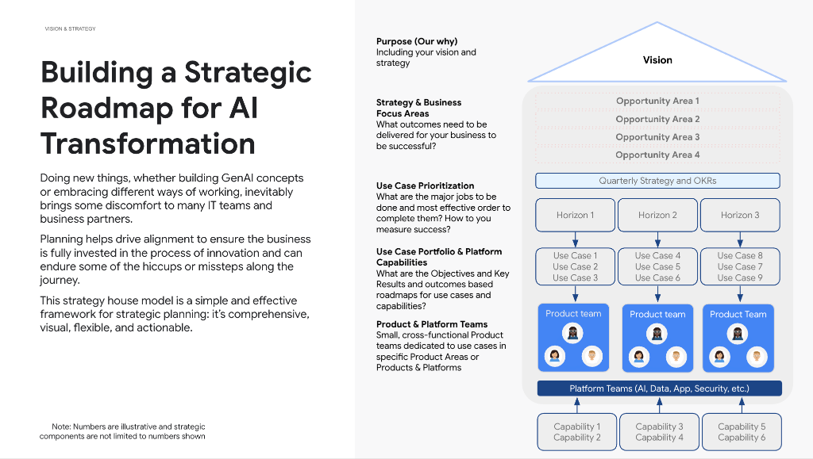
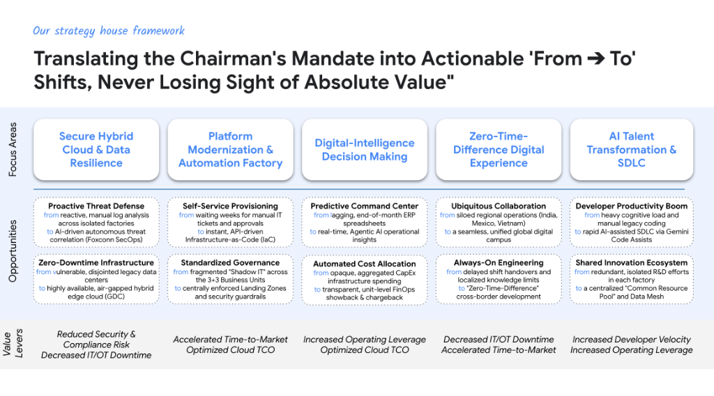
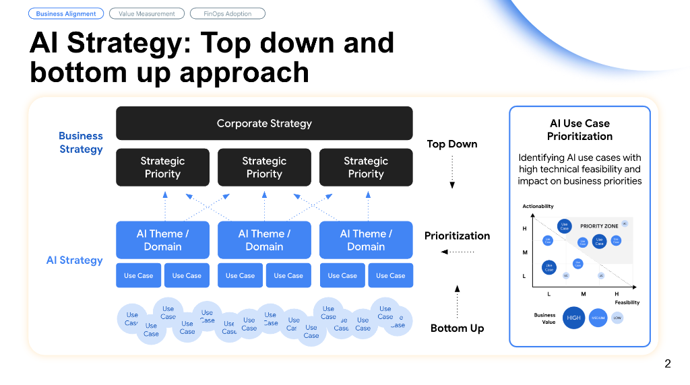

# Strategy House & Opportunity Matrix

This skill transforms financial and investor disclosures (10-K, 10-Q, earnings transcripts, analyst decks) into a 5-section **Strategy House** and **Phased Opportunity Matrix** (`docs/STRATEGY_HOUSE.md`).

---

## Mandatory Research Standards

1. **8-Quarter Evidence Window:** Ground every pillar, baseline metric, and bottleneck in the target company's last 8 quarters of public filings (10-K/10-Q, earnings call transcripts, investor presentations) or equivalent internal financial disclosures.
2. **Traceable Metrics:** Every Focus Area and OKR must cite the specific baseline figure and filing period (e.g., *"FY25 10-K Item 7: SG&A at 28.4% of revenue"*).

---

## 5-Section Deliverable Structure (`docs/STRATEGY_HOUSE.md`)

1. **Vision (The Roof):** Synthesize the company's mission, core strategic constraint, and target 3-year future state into a single cohesive paragraph (2–3 sentences, no sub-labels).
2. **Strategy & Business Focus Areas (The Pillars):** Define 3–5 Focus Areas. For each pillar, specify:
   - Core business problem and financial drag (with filing citation)
   - Target business outcome
   - From-To operational shift
3. **Prioritization & Opportunity Matrix (The Phases):** Organize 9–12 AI/digital initiatives across **3 Phases**:
   - **Phase 1: Stabilization & Foundation (Months 1–4)**
   - **Phase 2: Workflow Optimization (Months 5–8)**
   - **Phase 3: Autonomous Transformation (Months 9–12)**
   - Score every use case on **Business Value (1–5)**, **Technical Feasibility (1–5)**, and **Estimated Annual Impact ($M)**.
4. **Measure Success (OKRs & KPIs):** Define 3–6 Objectives and measurable Key Results (`Baseline -> Target -> Timeframe`), with at least one OKR per phase.
5. **Impacted Teams:** Identify at least 3 accountable business units or departments formatted as `Business Unit — Operational Change & Resource Requirement` (never name individuals).

---

## References, Visual Models & Examples

- [Strategy House Template](references/strategy-house-template.md): Section-by-section prompts and structure.
- [Technical Strategy Schema](references/strategy-schema.ts): TypeScript interface for structured Strategy House JSON export.
- [Worked Example: OmniRetail Corp Strategy House & Opportunity Matrix](examples/retail-omnichannel-strategy-house.md): Complete 5-section deliverable grounded in 8 quarters of retail 10-K/10-Q disclosures.
- Visual reference diagrams:
  - 
  - 
  - 
