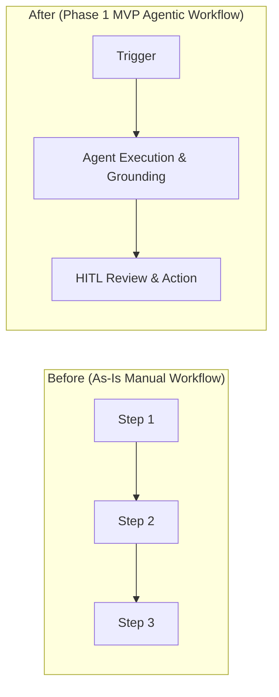

# Strategic Use Case Canvas & MVP Alignment Summary Template (`docs/USE_CASE_CANVAS.md`)

Use this combined **4-Worksheet Strategic Use Case Canvas + Official TDL Toolbox MVP Alignment Summary Document** template when generating `docs/USE_CASE_CANVAS.md`.

````markdown
# [Use Case Title] — Strategic Use Case Canvas & MVP Alignment Doc

- **Customer / Sponsor:** <Organization & Executive Sponsor>
- **Opportunity Area:** <High-level business domain>
- **Status:** <Draft | Discovery Aligned | Gate 1 Approved>
- **Last Updated:** <YYYY-MM-DD>

---

## Part I: Strategic Use Case Canvas (4-Worksheet Summary)

### 1. User Focus
* **USER TARGET:** <Specific internal role or external customer segment, headcount, and daily transaction volume>
* **USER PAINS:**
  * <Quantified pain point 1>
  * <Quantified pain point 2>
  * <Quantified pain point 3>
* **USER GAINS:**
  * <Measurable user benefit 1>
  * <Measurable user benefit 2>

### 2. Value Proposition
* **JOB-TO-BE-DONE:** <When [situation], help me [action] so I can [outcome]>
* **PRODUCT & SERVICES:**
  * <Core AI capability 1>
  * <Core AI capability 2>
* **STRATEGIC FIT (Revenue vs. Efficiency Levers):**
  * **Revenue Impact Lever:** <New product/service, enhanced feature, faster time-to-market, or CSAT lift>
  * **Efficiency Impact Lever:** <Workforce hours saved, bottleneck/handoff removed, accuracy gain, or reusable cross-LOB pattern>

### 3. Business Viability
* **IMPACT:** <Quantified Baseline KPI -> Target KPI and annualized dollar/hour impact>
* **INVESTMENT & TEAM READINESS:** <Customer GCP familiarity, SME availability, infra/license investment, workforce enablement>
* **EXECUTION BLOCKERS:** <Data access, security/compliance gates, third-party dependencies>

### 4. Technical Feasibility & Data Readiness (`Available / Usable / Quality`)
* **DATA READINESS AUDIT:**
  * **Available:** <Exists in sufficient volume/depth; permitted under privacy/consent policies>
  * **Usable:** <Centralized vs. siloed; clear owner & fast access approval; cataloged & AI-accessible>
  * **Quality:** <Accurate, consistently formatted, matches required frequency (real-time vs. batch)>
* **ARCHITECTURE & ENVIRONMENT:** <Target GCP environment, VPC/IAM status, OOTB vs. custom integration complexity, PII/PHI handling, technical debt>

---

## Part II: Official MVP Alignment Summary Document

### 1. Overview & Business Context
* **Use Case Description:** <Concise overview of the MVP agent workflow>
* **Business Problem:** <Specific operational bottleneck being solved in the 12-week engagement>
* **Business Objectives and Metrics (Must-Haves vs. Okay for Slippage):**

| Tier | Business Objective | Target Metric (`Baseline -> Target`) | Slippage Tolerance |
| :--- | :--- | :--- | :--- |
| **Non-Negotiable Must-Have** | <Objective 1> | <Metric 1> | Zero slippage (Gate 1/3 blocker) |
| **Non-Negotiable Must-Have** | <Objective 2> | <Metric 2> | Zero slippage |
| **Okay for Slippage (Stretch)** | <Objective 3> | <Metric 3> | Can defer to Eval Round 2 / Phase 2 |

### 2. Process CUJ Flow Chart (Before vs. After MVP Scope)


### 3. Phase 1 (MVP) Scope
* **Features In Focus for MVP Evaluation Round 1 (Demo 1 — early sprint read-out):**
  * <Feature 1>
  * <Feature 2>
* **Features In Focus for MVP Evaluation Round 2 (Demo 2/3 — later sprint read-outs):**
  * <Feature 3>
  * <Feature 4>
* **Features Not In Focus for MVP (Out of Scope):**
  * <Excluded Feature 1>
  * <Excluded Feature 2>
* **Datasets Needed for MVP:**
  * <Dataset 1 (owner, format, row/doc count, delivery date)>
* **Assumptions and Risks:**
  * <Assumption / Risk 1 + Mitigation>

### 4. Data Source & Agent Input/Outputs Mapping

**Solution Inputs (data sources, configs, APIs, MCPs, A2A agents):**

| Data Source | Access Method | Features Enabled |
| :--- | :--- | :--- |
| *e.g., Workday / Guidewire / BigQuery* | *REST API / MCP / SQL* | *Employee status verification, policy lookup, balance read* |

**Solution Outputs:**

| Data Source / Target System | Access Method | Features Enabled |
| :--- | :--- | :--- |
| *e.g., ServiceNow / Cloud SQL / UI* | *REST API / Webhook* | *Automated ticket filing, audit log write, structured triage packet* |

### 5. Evaluation and Testing Approach
* **Status Quo Quality:** <Current human baseline accuracy, MTTR, or error rate from `docs/baseline_kpis.json`>
* **UAT Required:** `<Yes / No>` (<Number of client SMEs and UAT sign-off window>)
* **Tentative Evaluation Metrics:**
  * **Metric:** `<Metric Name & Mathematical Definition>`
  * **Current Status Quo:** `<Baseline value>`
  * **Relevant Business Metric:** `<Linked P&L / operational KPI>`

### 6. (Future) Phase 2+ Scope
* **Long-Term Vision:** <Where the agent platform evolves post-12-week delivery>
* **Potential Future Features / Needs:**
  * <Phase 2 Feature 1>
  * <Phase 2 Feature 2>
````
